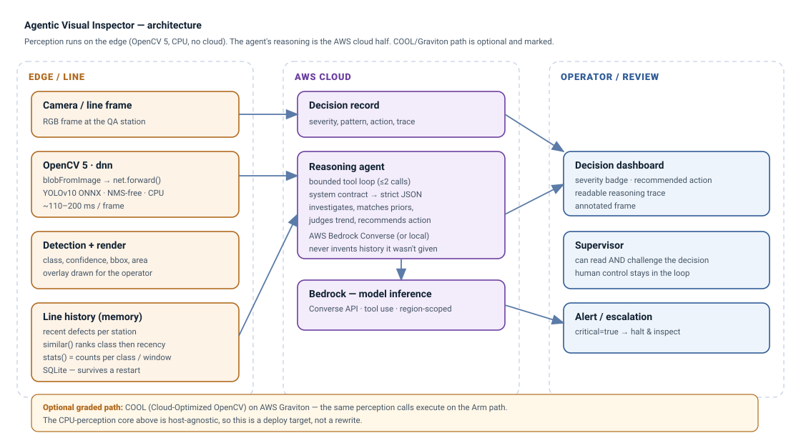

# Agentic Visual Inspector

**A vision system that doesn't just detect a defect — it investigates it against the line's
recent past and recommends an action a supervisor can read and challenge.**

Entry for the **OpenCV AI Competition 2026, powered by AWS**.



## The problem

QA lines miss subtle defects because inspectors fatigue, and they raise false alarms because a
detector cannot weigh context. An isolated blemish and the third identical blemish in an hour are
not the same event, but a per-frame detector reports them identically. Detection is a commodity;
**the decision is where the money and the safety are.**

## The idea

Two stages, and the second is the point:

1. **See** — OpenCV 5's DNN engine runs a YOLOv10 ONNX detector over a frame, on CPU, no cloud.
2. **Reason** — an agent receives the detection *plus the recent history on that line* and decides:
   is it critical, which prior defect does it resemble, what is the trend, what happens next. The
   output is a reasoning trace a supervisor can challenge, not a bare box.

## Verified results

| Piece | Status | Evidence |
|---|---|---|
| OpenCV 5 + ONNX detection, CPU | **working** | 5 detections (bus + 4 people) in **~110–135 ms**, no GPU |
| Agentic reasoning loop | **working** | investigated the bus detection, judged HIGH, matched a prior, recommended a halt, with a trace |
| Web endpoint (judge demo) | **working** | `POST /api/inspect` returns detections + decision + annotated frame |
| Pipeline tests | **passing** | `tests/test_pipeline.py` — perception, retrieval, contract + no-invented-history guard |

The unedited demo video (`demo.mp4`, 47 s) is the running system.

## The agentic part

A single prompt is not agency. The reasoner is a **bounded tool loop**: it receives the detection
and retrieved priors, may call `get_line_history(station, limit)` at most twice if the window looks
thin, and returns strict JSON:

```json
{"critical": true, "severity": "high", "matched_prior": "D-56134",
 "pattern": "...", "action": "...", "reasoning": "..."}
```

Retrieval ranks **class match first, recency second** — the two signals a human uses when they say
"this looks like the one from an hour ago". The system prompt forbids inventing history, and a test
enforces it: any cited prior must be one the agent was actually given.

## AWS

The reasoning inference is the AWS component. `opencv_inspector/reasoning.py` ships two identical-contract
backends — a local OpenAI-compatible one (used for development) and **Amazon Bedrock Converse**:

```sh
export REASONING_BACKEND=bedrock
export BEDROCK_MODEL_ID=anthropic.claude-3-5-sonnet-20241022-v2:0
export AWS_REGION=us-east-1
```

The loop, prompt and output shape do not change — only the transport. Scale-out is intended on
**COOL (Cloud-Optimized OpenCV) on Graviton**, since the perception calls are host-agnostic.
**Honestly: the Bedrock path is implemented and wired but has not been run against a live AWS
account**, because none was available during development. The contract is verified locally.

## Run it

```sh
python -m venv .venv && . .venv/bin/activate
pip install -r requirements.txt
python detect.py            # perception check: prints detections, writes detected.jpg
python app.py               # web endpoint on http://127.0.0.1:5092
python tests/test_pipeline.py
```

## Layout

```
app.py                  web endpoint (judge demo)
detect.py               standalone perception check
opencv_inspector/
  detector.py           OpenCV 5 DNN + ONNX, render overlay
  reasoning.py          bounded tool loop; Local + Bedrock backends
  line_history.py       retrieval over the line's recent defects
tests/test_pipeline.py  perception, retrieval, contract + grounding guard
REPORT.md / REPORT.pdf  technical report
ARCHITECTURE.svg        the diagram above
BUILD.md                exact build / deploy / test
```

See **`REPORT.md`** for the full technical report, including limitations and responsible-use
considerations.
